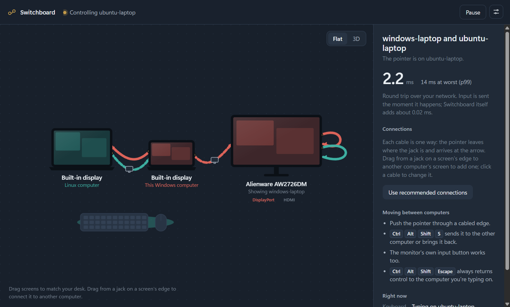
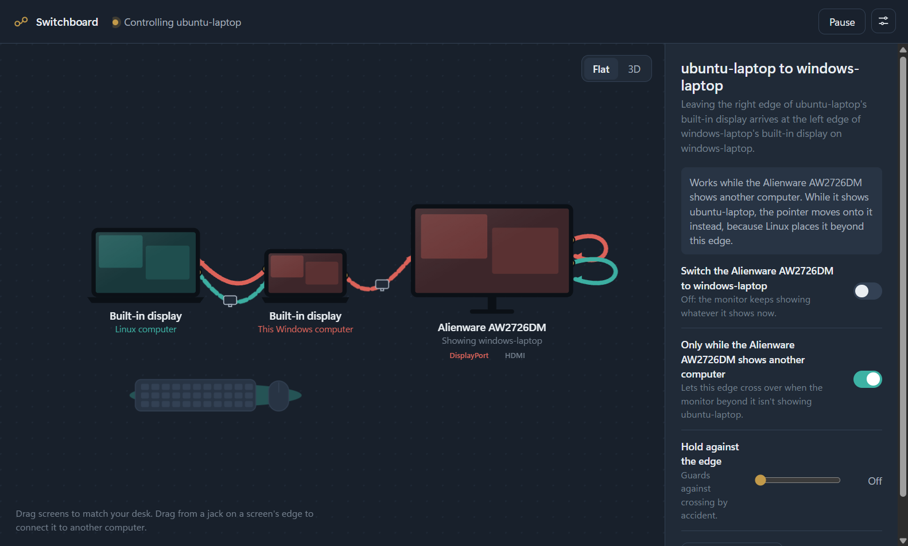
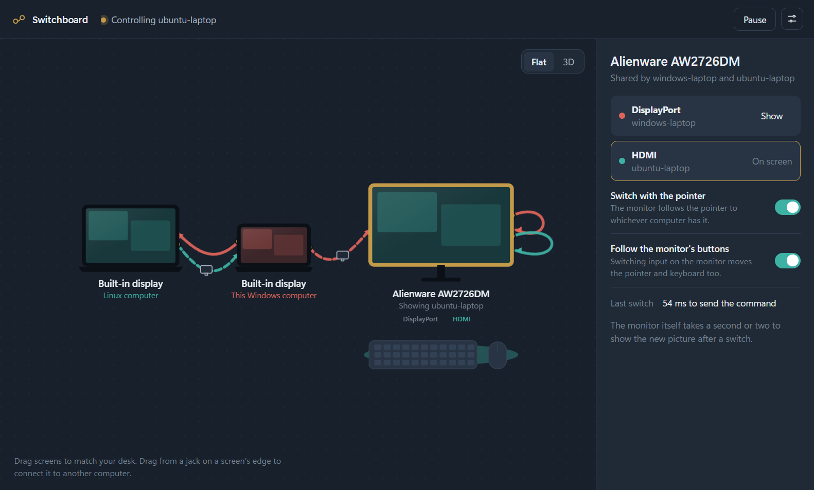
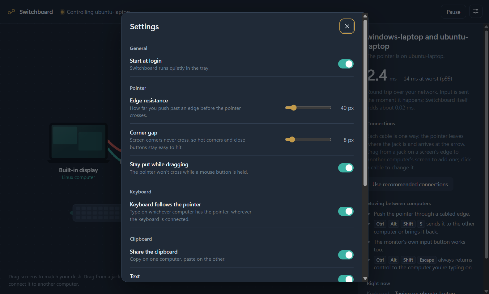

<p align="center">
  
</p>

<h1 align="center">Switchboard</h1>

<p align="center">
  <b>Two computers. One desk. One mouse.</b><br/>
  Push the pointer off the edge of one screen and it appears on the other computer. Your keyboard follows it, the clipboard comes along, and the monitor you share between them switches inputs by itself.
</p>

<p align="center">
  <a href="https://github.com/Atrix21/switchboard/releases/latest"></a>
</p>

<p align="center">
  <a href="https://github.com/Atrix21/switchboard/actions/workflows/ci.yml"></a>
  
  
  
  
  
</p>

<p align="center">
  
</p>

<p align="center"><sub>The real app in demo mode. The keyboard and mouse move to whichever computer has the pointer; the big monitor glows in the colour of the computer it's showing.</sub></p>

---

## The problem

You have two computers on one desk. You have two mice. You reach for one of them and it is, reliably, the other one.

You could buy a hardware KVM, which switches your keyboard and mouse with a button and a satisfying clunk. You will then press that button roughly four hundred times a day, and it will switch the monitor too, every time, whether you wanted it to or not.

Switchboard is the version where you just move the mouse.

## What it does

- **One pointer, two computers.** Push it through a screen edge and it carries on onto the other computer. Clicks, drags, both scroll wheels, back and forward buttons. Every movement your mouse reports is sent the moment it happens, at its full polling rate.
- **The keyboard follows the pointer.** Type on whichever computer has the pointer, wherever the keyboard is physically plugged in or paired. If your keyboard has its own Bluetooth host-switch keys, those keep working too. Switchboard doesn't touch them.
- **The monitor switches itself.** A monitor connected to both computers changes input over DDC/CI when you cross. Press the monitor's own input button instead and the pointer and keyboard follow *that*. It's a two-way relationship.
- **You draw the connections.** The app shows your actual desk: your computers, their screens, your keyboard and mouse. Drag from an edge of one screen to another computer to connect them. Each connection is a one-way cable, so the picture is never ambiguous about where the pointer will go.
- **Clipboard, including files.** Copy text or an image on one computer and paste it on the other. Copy a folder, move the pointer across, paste. It arrives in its own folder and never overwrites anything.
- **Pairing, not accounts.** Computers find each other on your network and pair by showing the same six-digit code. No sign-in, no cloud, nothing leaves your LAN, and everything on the wire is encrypted.
- **Built to never strand you.** If the other computer crashes, sleeps, or the Wi-Fi drops, control comes back to the computer in front of you within a second, and every held button and key is released. <kbd>Ctrl</kbd>+<kbd>Alt</kbd>+<kbd>Shift</kbd>+<kbd>Esc</kbd>, or holding all three mouse buttons, always brings it home.

<table>
  <tr>
    <td width="50%"></td>
    <td width="50%"></td>
  </tr>
  <tr>
    <td align="center"><sub>Your desk, as it actually is. The keyboard sits wherever you're typing.</sub></td>
    <td align="center"><sub>Every cable is one-way. Click one to see exactly what it does, and when.</sub></td>
  </tr>
  <tr>
    <td width="50%"></td>
    <td width="50%"></td>
  </tr>
  <tr>
    <td align="center"><sub>One monitor, two inputs, no more fumbling for its buttons.</sub></td>
    <td align="center"><sub>Settings apply as you change them. Nothing to remember to save.</sub></td>
  </tr>
</table>

## Download

**[Get the latest release →](https://github.com/Atrix21/switchboard/releases/latest)**

| File | For |
| --- | --- |
| `switchboard-x.y.z-windows-x64.zip` | Windows 11 (Windows 10 should work but hasn't been tested). Unzip and run `install.ps1`. Installs for your user, no admin needed (except one optional firewall prompt). |
| `switchboard_x.y.z_amd64.deb` | Ubuntu 24.04 on X11 or Wayland (tested), or other Debian-based distributions with WebKitGTK 4.1. `sudo apt install ./switchboard_*.deb` |

Install it on both computers. Open it on both. Click **Pair**, check that the codes match, done.

<details>
<summary><b>Windows install, in detail</b></summary>
<br/>

```powershell
Expand-Archive switchboard-0.1.0-windows-x64.zip -DestinationPath switchboard
powershell -ExecutionPolicy Bypass -File switchboard\install.ps1
```

It copies two small executables to `%LOCALAPPDATA%\Programs\Switchboard`, adds a Start menu entry and starts it at login. To let the other computer reach this one, it asks once for administrator approval to add firewall rules limited to your local subnet. `uninstall.ps1` removes everything again.

**About the blue "Windows protected your PC" box.** You'll probably see it. Windows shows it for apps that aren't signed with a paid certificate. Click **More info → Run anyway**, or build it yourself (below) and be your own certificate authority.

</details>

<details>
<summary><b>Ubuntu install, in detail</b></summary>
<br/>

```bash
sudo apt install ./switchboard_0.1.0_amd64.deb
```

The package adds the app to your applications, starts it at login, and installs a udev rule so your user can create Switchboard's virtual pointer (`/dev/uinput`) without root. Monitor control uses the I²C access that Ubuntu's `ddcutil` package already grants the desktop user.

If `ufw` is enabled, let your other computer in:

```bash
sudo ufw allow from 192.168.0.0/16 to any port 47801 proto tcp
sudo ufw allow from 192.168.0.0/16 to any port 47801,47802 proto udp
```

**If the pointer feels laggy on Wi-Fi, check power saving first.** Ubuntu turns on Wi-Fi power saving by default, which on the development laptop made the median round trip **255 ms**. Turning it off for your home network made it **2 ms**:

```bash
nmcli connection modify "<your network>" 802-11-wireless.powersave 2
```

</details>

### Or build it yourself

```bash
git clone https://github.com/Atrix21/switchboard.git
cd switchboard
cargo build --release                       # the service and command line
cargo build --release -p switchboard-app    # the desktop app
```

Needs Rust. On Ubuntu the desktop app also needs `libwebkit2gtk-4.1-dev libgtk-3-dev libayatana-appindicator3-dev`; the service itself has no system dependencies. Packaging: `packaging/windows/build-release.ps1` and `packaging/linux/build-deb.sh`.

Want to look around first? `switchboard-app --demo` runs the app against a pretend desk, with no service and no hardware involved. Every image in this README comes from it (`scripts/capture.ps1`).

## Using it

Move the pointer through a cabled edge. That's most of it.

| Shortcut | Does |
| --- | --- |
| <kbd>Ctrl</kbd>+<kbd>Alt</kbd>+<kbd>Shift</kbd>+<kbd>S</kbd> | Send the pointer to the other computer, or bring it back |
| <kbd>Ctrl</kbd>+<kbd>Alt</kbd>+<kbd>Shift</kbd>+<kbd>Esc</kbd> | Take control back on this computer and pause forwarding |
| Hold left + right + middle mouse buttons | The same, for when the keyboard is on the other computer |
| The monitor's input button | Moves the pointer and keyboard to the computer it now shows |

<details>
<summary><b>Connections</b>: drawing your desk</summary>
<br/>

Open the app and drag the screens into the order they really sit in. Then drag from a jack on a screen's edge to a screen on the other computer. Click any cable to choose:

- **Switch the shared monitor**, or leave it showing whatever it shows.
- **Only while the shared monitor shows the other computer.** This exists for a specific, very common problem: your OS thinks the shared monitor sits right next to your laptop screen, so "right of the laptop" means two different things depending on which computer the monitor is showing. With this on, the edge goes to the other computer when the monitor isn't showing you, and onto the monitor when it is.
- **Hold against the edge** for a moment first, for edges you'd rather not cross by accident.

**Use recommended connections** sets up something sensible for the arrangement you've drawn. Edges your OS makes impossible are drawn as red dashes with an explanation, rather than silently doing nothing.

</details>

<details>
<summary><b>Command line</b></summary>
<br/>

```text
switchboard run                         start the service
switchboard status                      who's connected, where the pointer is, latency
switchboard pair 192.168.1.20           pair with another computer
switchboard confirm                     confirm the six-digit code
switchboard switch [peer|local]         move the pointer
switchboard monitor list|get|set hdmi   talk to your monitor directly over DDC/CI
switchboard clip get                    what's on this computer's clipboard
switchboard bench net <host>            measure your network the way Switchboard uses it
switchboard selftest                    (Windows) prove the input capture path works
```

</details>

<details>
<summary><b>Where it keeps things</b></summary>
<br/>

| What | Windows | Linux |
| --- | --- | --- |
| Settings (`switchboard.toml`) | `%APPDATA%\Switchboard` | `~/.config/switchboard` |
| This computer's key | `identity.key`, next to the settings | same, mode `0600` |
| Log | `switchboard.log`, next to the settings | same |
| Received files | `Downloads\Switchboard\<time>\` | `~/Downloads/Switchboard/<time>/` |

</details>

## How fast is it?

Measured on the development pair: two laptops on the same 5 GHz Wi-Fi. Method and raw numbers in [BENCHMARKS.md](BENCHMARKS.md).

| | |
| --- | --- |
| Time Switchboard adds per movement (capture, encrypt, send; receive, decrypt, inject) | about **0.02 ms** |
| Wi-Fi round trip, typical | **1.3–2.3 ms** |
| Wi-Fi round trip, 99th percentile | 5–21 ms |
| Memory | 4 MB (Linux) to 14 MB (Windows) |
| CPU while idle | under 1% of one core |

The network is the slow part, and on Wi-Fi it occasionally hiccups for 15–20 ms. A cable on either computer makes that go away. Switchboard sends input over UDP in a form where a lost or late packet costs nothing (each one carries the full state), so it doesn't stall behind a hiccup the way TCP does: at the 99th percentile, TCP was 2–5× slower on the same network.

### Where the delay is (and isn't)

**The computer your mouse and keyboard are connected to gets no added latency.** While the pointer is there, Switchboard only watches input; it isn't in the path. On Windows it uses Raw Input, which observes. The hooks that can block or delay input are installed only while the pointer is somewhere else, and removed when it returns. On Ubuntu it reads raw events and grabs nothing until the pointer leaves. The mouse and keyboard behave exactly as they would without Switchboard.

**The other computer carries all of it:** one network hop (about half the round trip, so roughly 1 ms on good Wi-Fi) plus a few microseconds to apply the input. The app shows both side by side under *Where the delay is*.

Two honest footnotes. The mouse and monitor still have their own latency, same as ever; Switchboard just doesn't add to it. And the keyboard follows the pointer, so if the keyboard is plugged into one computer while the pointer is on the other, typing crosses the network too (a Bluetooth keyboard paired directly to each computer doesn't).

## Frequently anticipated questions

**Is this remote desktop?**
No. Nothing is streamed. Each computer drives its own screens; Switchboard only moves your input and your clipboard between them. It's a KVM without the V.

**Isn't this Synergy / Barrier / Input Leap / Mouse Without Borders?**
Same idea, different priorities: it switches a shared monitor over DDC/CI and follows that monitor's own buttons, it lets you draw one-way connections for a monitor shared between two computers, its input survives packet loss by design, and everything is mutually authenticated and encrypted from the first byte. If one of those already works for you, that's fine. This one was built for a desk that had two mice too many.

**Why does the monitor take a second to change?**
Switchboard tells it to switch in about 60 ms. The monitor then spends 1–3 seconds re-syncing to the new signal, the same as when you press its button. We have spoken to it about this.

**Is it secure?**
Computers pair once by comparing a code derived from the encryption handshake, so a machine in the middle can't fake it. After that, every connection is mutually authenticated (Noise XX, X25519, ChaCha20-Poly1305), and the service refuses connections from outside your local network. The details are in [ARCHITECTURE.md](ARCHITECTURE.md#security).

**Does it phone home?**
It doesn't have a home. No accounts, no telemetry, no cloud. Two computers on your desk talk to each other, and that is the whole relationship.

**Why is the app a web view? You said no Electron.**
It uses the web view your OS already has (WebView2 on Windows, WebKitGTK on Ubuntu), so the app is about 4 MB, not 150. It's also a separate process from the part that handles your input, so if the window crashes, your mouse doesn't notice.

**Why is there a 3D view?**
Honestly? Because it looks good. It's also the same desk and the same controls, so you can arrange things in it, but nobody needs to.

**Does it work with admin windows on Windows?**
Not yet. Windows doesn't let an unelevated app send input to elevated windows, the lock screen, or UAC prompts. That's on the [roadmap](ROADMAP.md).

**Wayland? macOS? Three computers?**
Ubuntu on X11 and Windows today. Injection already uses the same kernel path Wayland would; capture is the missing piece. macOS and more than two computers are planned, and the architecture leaves room for both.

## How it's built

```text
src/                 The service: one Rust binary, no async runtime, a handful of threads.
  engine.rs          Who has the pointer, forwarding, keyboard focus, watchdogs, pairing.
  proto.rs, net.rs   Loss-proof input snapshots over UDP; Noise-encrypted TCP for everything else.
  platform/windows   Raw Input, low-level hooks, SendInput, DDC/CI via dxva2, clipboard.
  platform/linux     XInput2, XTest and uinput, DDC/CI over i2c-dev, X11 selections.
ui/                  The desktop app: tray icon plus the desk (flat SVG and three.js 3D).
tests/               An end-to-end test that runs two real services and drops half their packets.
```

<details>
<summary><b>The details, for people who read the details</b></summary>
<br/>

- **Input snapshots.** Every packet carries cumulative motion, the current buttons, and the last sixteen button changes, each stamped with where the pointer was at that instant. Lose a packet and the next one carries everything; clicks still land exactly where they happened. The end-to-end test passes byte-for-byte with 50% of packets deliberately dropped.
- **Full polling rate on Windows 11**, which throttles background apps' Raw Input to roughly 125 Hz. While forwarding, Switchboard reads from a low-level hook instead, which Windows has to call for every event. Those hooks only queue events and return (11 µs at worst, measured), because a slow hook freezes the whole desktop's input. A self-test exercises the real hook path before every deploy.
- **Pointer feel.** Motion leaves Windows with your Windows pointer settings already applied, and Linux injects it through a virtual pointer with acceleration switched off, so the pointer covers the same ground per hand movement on both computers.
- **Monitor control** talks DDC/CI natively on both systems (about 60 ms per switch on Windows), only opens I²C buses that belong to display adapters, and identifies your monitor by its EDID model, not a guess.
- **Design decisions**, including the ones that turned out wrong and were changed, are written down in [DECISIONS.md](DECISIONS.md). What's verified on real hardware versus only in tests is in [TESTING.md](TESTING.md).

</details>

## Contributing

Issues and pull requests are welcome. Run `cargo test` and `python tests/e2e_loopback.py <path to switchboard binary> 2` before sending anything; the second one starts two services, drops half their packets, and checks that nothing noticed. CI runs both on Windows and Ubuntu.

## License

[MIT](LICENSE). Use one mouse. Put the other one in a drawer.
